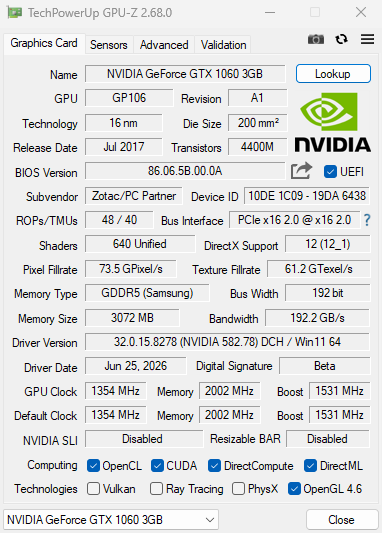

# P106-90 Unlock X16

## 中文说明

将 NVIDIA P106-90 / `10DE:1C09` 的 PCIe 链路宽度从 `x4` 解锁到 `x16` 的
UEFI EFI 注入方案。

> 本项目目标是 **PCIe x16 宽度解锁**，不独立承诺 Gen2 / Gen3 速率提升。
> EFI 参数名 `pcie-gen2-x16` 是 NVPermissive 二进制自带的模式名；实际
> 链路速率由 GPU、主板和当前训练状态共同决定。

本项目会修改 Windows EFI System Partition 和固件启动顺序，并访问 GPU
寄存器。请在可恢复平台测试，并保留 Windows 安装 U 盘作为恢复手段。

### 实测截图



截图中的关键结果是：

```text
Bus Interface: PCIe x16 2.0 @ x16 2.0
```

`@ x16` 才是本项目的目标，表示链路宽度已经达到 x16。速率字段只是当前
链路状态，不作为本项目的独立解锁承诺。

### 宽度证据

```text
GPU LnkCap = 0x00453d02  -> MAXWIDTH = 16
GPU LnkSta = 0x1102      -> WIDTH = 16
RP  LnkCap = 0x0261ad03  -> MAXWIDTH = 16
RP  LnkSta = 0xd102      -> WIDTH = 16
```

### 原理

开机时由 UEFI Shell 执行 NVPermissive 的宽度事务：

```text
NVPermissiveEFI.efi pcie-gen2-x16
```

命令名里带有 `gen2`，但本项目的目标是执行 P106-090 的 x16 宽度事务。
成功后，Shell 自动扫描并启动 Windows Boot Manager。

最终宽度仍取决于卡的 `LNKCAP.MAXWIDTH`、PCB lane 走线、AC 耦合电容、金手指
触点、插槽 bifurcation 和根端口能力。EFI 不能补出物理上不存在的 lane。

### 发布文件

编译好的 EFI 和 UEFI Shell 不放在源码仓库，请从 Release 下载：

```text
https://github.com/DaZuiZZZZ/P106-90-Unlock-X16/releases
```

推荐资产：

```text
P106-090-x16-uefi-shell-installer.zip
P106-090-x16-persist-usb.zip
```

### 快速开始

1. 关闭 Secure Boot。
2. 准备一个 FAT32 U 盘。
3. 下载 `P106-090-x16-uefi-shell-installer.zip`。
4. 解压后运行 `make-installer-usb.cmd`，把安装器写入 U 盘。
5. 从 U 盘启动一次。
6. 安装器会复制文件到 ESP，并通过 `bcfg` 添加启动项：

```text
NVPermissive P106-090 x16
```

7. 关机，拔掉 U 盘，重启。
8. 在 BIOS 中把 `NVPermissive P106-090 x16` 设为第一启动项。

之后每次开机都会先执行 x16 宽度事务，再进入 Windows。

### 源码结构

```text
.
├── README.md
├── assets/
│   └── gpu-z-x16.png
├── uefi-shell-installer/
│   ├── make-installer-usb.cmd
│   ├── usb-template/
│   │   ├── install-local.nsh
│   │   ├── startup.nsh
│   │   ├── startup-esp.nsh
│   │   └── License.txt
│   └── tools/
│       └── check-usb-volume.ps1
├── persistent-usb/
│   ├── make-p106-090-x16-persist-usb.bat
│   ├── usb-template/
│   │   ├── startup.nsh
│   │   └── README-FIRST.txt
│   └── tools/
│       └── check-usb-volume.ps1
├── legacy-local-efi-install/
│   ├── install.cmd
│   ├── install.ps1
│   ├── uninstall.cmd
│   └── usb-template/
│       └── startup.nsh
└── docs/
    ├── P106-090-EFI-X16说明.md
    ├── P106-090-实测基线.md
    └── PCIe宽度与型号差异.md
```

### 卸载

进入 UEFI Shell：

```text
bcfg boot dump
```

找到 `NVPermissive P106-090 x16` 的编号，例如 `Boot0003`：

```text
bcfg boot rm 3
```

然后删除 ESP 上的：

```text
\EFI\NVPermissive\
\startup.nsh
```

删除 `\startup.nsh` 前确认它不是主板原有文件。

### 免责声明

本项目仅用于研究和恢复自有硬件。错误操作可能导致无法启动、显卡掉卡或需要
恢复 BIOS。请自行备份并承担风险。

---

## English

This project unlocks the NVIDIA P106-90 / `10DE:1C09` PCIe link **width**
from `x4` to `x16` through a UEFI EFI injection.

> The project's target is PCIe x16 width. It does not independently promise a
> Gen2 or Gen3 speed upgrade. The `pcie-gen2-x16` argument is the mode name
> exposed by the NVPermissive binary.

### Verified Screenshot


The relevant result is:

```text
Bus Interface: PCIe x16 2.0 @ x16 2.0
```

`@ x16` is the project's target. The speed field only describes the current
link state.

### Width Evidence

```text
GPU LnkCap = 0x00453d02  -> MAXWIDTH = 16
GPU LnkSta = 0x1102      -> WIDTH = 16
RP  LnkCap = 0x0261ad03  -> MAXWIDTH = 16
RP  LnkSta = 0xd102      -> WIDTH = 16
```

### How It Works

The UEFI Shell runs the NVPermissive width transaction:

```text
NVPermissiveEFI.efi pcie-gen2-x16
```

The EFI application writes the P106-090 PCIe width transaction registers and
waits for the link to stabilize. It then starts Windows Boot Manager.

Final width still depends on the card's `LNKCAP.MAXWIDTH`, PCB lane routing,
AC coupling capacitors, PCIe edge contacts, slot bifurcation, and root port
capability. EFI cannot create physical lanes that do not exist.

### Release Assets

Prebuilt EFI and UEFI Shell binaries are not stored in the source repository:

```text
https://github.com/DaZuiZZZZ/P106-90-Unlock-X16/releases
```

Recommended assets:

```text
P106-090-x16-uefi-shell-installer.zip
P106-090-x16-persist-usb.zip
```

### Quick Start

1. Disable Secure Boot.
2. Prepare a FAT32 USB drive.
3. Download `P106-090-x16-uefi-shell-installer.zip`.
4. Run `make-installer-usb.cmd` to write the installer to the USB drive.
5. Boot from that USB once.
6. The installer copies files to the ESP and creates this boot entry:

```text
NVPermissive P106-090 x16
```

7. Power off, remove the USB drive, and reboot.
8. Set `NVPermissive P106-090 x16` as the first boot entry in BIOS.

### Uninstall

From UEFI Shell:

```text
bcfg boot dump
```

Find the entry named `NVPermissive P106-090 x16`, for example `Boot0003`:

```text
bcfg boot rm 3
```

Then remove from the ESP:

```text
\EFI\NVPermissive\
\startup.nsh
```

Confirm that `\startup.nsh` was not originally created by the motherboard before
removing it.

### Disclaimer

This project is for research and recovery of hardware you own. Incorrect use may
cause boot failure, GPU link loss, or BIOS recovery. Back up your system and
accept the risk before use.
